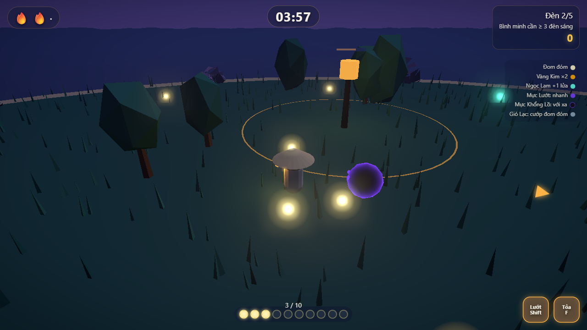

# Đảo Đèn Lồng 🏮

> 🎬 **Video demo (3:42):** [docs/demo/demo.mp4](docs/demo/demo.mp4) · cũng đính kèm ở [Release v1.0.0](https://github.com/b-baocode/K5-L3A-DAY12-NgoGiaBao-2A202603482-AI-SDLC-Dao-Den-Long/releases/tag/v1.0.0). Ghi trực tiếp từ game chạy thật (cửa sổ 1280×720); phần chơi do script điều khiển bằng phím thật, vài tình huống được dựng sẵn để rút gọn; phần bằng chứng hiển thị lại output thật của `npm test`, headless, proof, soak, bench vừa chạy.

Game 3D góc nhìn thứ ba, phong cách low-poly cổ tích. Mây, người giữ đèn nhỏ tuổi đội nón lá, gom đom đóm để thắp và **giữ sáng** các Đèn Lồng Lớn tới bình minh qua 3 Đêm: **Đảo Bến**, **Đảo Cau**, **Đảo Chuông**. Né Bóng Mực (chúng hút dầu đèn!) và Gió Lạc (cướp đom đóm).

Bài lab cá nhân Day 12 AI SDLC — Ngô Gia Bảo, 2A202603482. Test Contract **v1.3**.



## Yêu cầu hệ thống
- **Node.js ≥ 20** (đã thử 22.12), npm. macOS, Linux hoặc Windows.
- Trình duyệt có WebGL2 (Chrome, Edge, Firefox, Safari mới). Benchmark tự tải Chrome for Testing qua `puppeteer` khi `npm install`.
- GPU: chạy tốt trên GPU tích hợp (Intel UHD: bench avg 136 FPS, xem [bench.json](bench.json)).

## Cài đặt và chạy (3 lệnh)
```bash
git clone https://github.com/b-baocode/K5-L3A-DAY12-NgoGiaBao-2A202603482-AI-SDLC-Dao-Den-Long.git && cd K5-L3A-DAY12-NgoGiaBao-2A202603482-AI-SDLC-Dao-Den-Long
npm install
npm start          # tự build lần đầu, mở http://localhost:5174 ; bảng xếp hạng lưu ở data/leaderboard.json
```
Không cài Node? Tải **bản web tĩnh** `dao-den-long-web-v1.0.0.zip` ở Release, giải nén và mở bằng bất kỳ server tĩnh nào (vd. `npx serve dist`). Bản tĩnh lưu bảng xếp hạng trong trình duyệt.

## Điều khiển (đổi được trong Cài đặt)
| Mặc định | Hành động |
|---|---|
| W A S D | Di chuyển (theo hướng camera) |
| Kéo chuột trái · Q / C | Xoay camera |
| Space | Nhảy |
| Shift | Lướt (14 m/s trong 0.2 s, hồi 1.5 s) |
| E | Nạp đom đóm vào đèn / châm dầu |
| F hoặc chuột phải | Tỏa Sáng (3 đom đóm, choáng Bóng Mực trong 5 m) |
| P hoặc Esc | Tạm dừng (Tiếp tục · Chơi lại Đêm · Cài đặt · Về menu) |
| F3 | Hiện FPS |

**Cài đặt:** âm lượng, độ nhạy chuột, đổi phím (báo trùng phím, nút "Khôi phục mặc định"), bảng màu dễ phân biệt (mù màu), giảm chuyển động (tắt rung camera và chớp màn hình), chữ lớn ×1.25, hiệu ứng hậu kỳ. Tất cả được lưu.

## Luật và điểm (Ticket-03)
- **Mục tiêu:** sống tới bình minh với đủ đèn đang sáng: Đêm 1 cần 3/5, Đêm 2 cần 4/6, Đêm 3 cần 5/7. Đêm dài 240 / 270 / 300 s.
- **Đèn có dầu:** thắp xong dầu 100, hao 1/giây; bấm E ở đèn đang sáng để châm (+10 dầu mỗi đom đóm). Hết dầu đèn tắt; thắp lại chỉ cần 5 đom đóm. Đèn dưới 30 dầu mất vùng an toàn, nhấp nháy, và Bóng Mực sẽ tới hút dầu.
- **Sức chứa** 10, +2 mỗi lần thắp thành công (tối đa 20). Bị Bóng Mực chạm: −1 Ngọn Lửa (có 3), rơi nửa số đom đóm. Rơi khỏi đảo: −1 Ngọn Lửa, mất hết đom đóm.
- **Gió Lạc** (Đêm 2–3) cướp 3 đom đóm khi bạn mang ≥ 5; Tỏa Sáng để lấy lại. **Bùa Gió**: chạy nhanh, Lướt không hồi chiêu trong 10 s.

| Sự kiện | Điểm |
|---|---|
| Mỗi đom đóm nạp vào đèn (thắp, thắp lại, châm dầu) | +5 |
| Thắp lần đầu / thắp lại | +100 / +40 |
| Bóng Mực trúng Tỏa Sáng (đang hút dầu) | +5 (+15) |
| Bình minh khi thắng: mỗi đèn đang sáng | +50 + phần nguyên dầu còn lại |
| Bình minh khi thắng: mỗi Ngọn Lửa | +50 |

Tổng điểm = tổng điểm các Đêm đã thắng. **Bảng xếp hạng** (top 10) từ menu chính; lưu điểm sau màn Bình Minh hoặc khi thua.

## Test, headless, benchmark, soak
```bash
npm test                                                     # 69 test: luật, dầu đèn, Contract v1.3, bảng xếp hạng, bench, soak
node src/headless.js --seed 1 --night 2 --ticks 600 --out out.jsonl [--scenario f.json] [--inputs f.json] [--snapshot-every 10]
node scripts/bench.js --seed 42 --duration 30 --out bench.json   # mở cửa sổ 1280x720, cảnh chuẩn 200 Bóng Mực
node --expose-gc --no-opt --max-semi-space-size=1 --min-semi-space-size=1 scripts/soak.js --seed 7 --nights 10 --out soak.json
node scripts/run.js --export-leaderboard out.json            # xuất bảng xếp hạng {"entries": [...]}
npm run proof -- phase-3                                     # 19 scenario chạy 2 lần, so sánh tất định
```
- Contract: [`game.contract.json`](game.contract.json) (v1.3: `bench_cmd`, `soak_cmd`). Mã thoát headless: 0 ok, 2 file inputs/scenario sai, 1 lỗi khác.
- **Bench** (kết quả của tôi: [bench.json](bench.json), chi tiết [BENCH.md](docs/proof/phase-4/BENCH.md)): Chrome thật, không headless, vsync GPU tắt (`--disable-gpu-vsync`). Bộ giới hạn khung của Chrome được **giữ** vì tắt nó làm rAF chạy vượt GPU (khung "3 ms" rồi treo 200 ms), không phản ánh thời gian khung thật. `peak_mem_mb` = tổng RSS các tiến trình trình duyệt.
- **Soak** (kết quả: [soak.json](soak.json)): 10 Đêm trong một tiến trình, 0 crash, RSS 38.8 → 39.7 MB (Linux ~49 → 50 MB). Chạy V8 cấu hình tiết kiệm bộ nhớ — lý do trong `scripts/soak.js` và CHANGELOG. Input ngẫu nhiên thường đi ra khỏi đảo nên mỗi Đêm kết thúc sớm bằng `no_flames` (chi tiết `per_night`).

## Cấu trúc
```
game.contract.json   Test Contract v1.3 (tuning = số chuẩn)
src/sim/             luật game thuần JS, tất định (web + headless): game.js, maps.js, bench.js, leaderboard.js, validate.js
src/headless.js      CLI headless
src/web/             Three.js: main.js (game, HUD, menu, cài đặt), visuals.js (trời, cỏ, bloom…)
scripts/             run.js (chạy game + bảng xếp hạng), bench.js, soak.js, proof.js
tests/  scenarios/   node:test + scenario
docs/notes/          giả định & tiêu chí từng phase, nhật ký AI, retro · docs/adr/ quyết định thiết kế · docs/proof/ bằng chứng
AGENTS.md CLAUDE.md .claude/   harness AI (hook chặn kết thúc khi test đỏ, skill verify)
```

## Sáng tạo của tôi
Chỉ bật trong game web (`extras`); headless, bench và soak **không** bật nên số đo và đầu ra contract không đổi.
- Đom đóm **Vàng Kim** (×2 ánh sáng) và **Ngọc Lam** (+1 Ngọn Lửa); **Mực Lướt** (nhanh) và **Mực Khổng Lồ** (chậm, với xa).
- Ánh sáng bay từ đèn trên nón Mây vào Đèn Lồng Lớn; Bóng Mực run và co lại gần đèn; hạt sáng chảy khi Bóng Mực hút dầu.
- Âm thanh tự tổng hợp bằng Web Audio (nhạc nền, hiệu ứng), lời kể của Ông Đăng.
- Phong cách low-poly: trời sao, cỏ lay theo gió (mạnh hơn khi Gió mạnh), đá tinh thể, bloom + vignette, camera lượn ở menu.

Bằng chứng phần cũ vẫn đúng: [extras-headless-unchanged.txt](docs/proof/phase-1/extras-headless-unchanged.txt), `tests/extras.test.js` (headless không được bật `extras`), proof mỗi phase tất định.

## Tài liệu
- Giả định, tiêu chí nghiệm thu, bằng chứng: [Phase 1](docs/notes/phase-1.md) · [Phase 2](docs/notes/phase-2.md) · [Phase 3](docs/notes/phase-3.md) · [Phase 4](docs/notes/phase-4.md)
- [ADR 0001 — đèn có dầu, thắng ở bình minh](docs/adr/0001-lantern-fuel-and-dawn-win.md) · [CHANGELOG](CHANGELOG.md) · [Retro](docs/notes/retro.md) · [Nhật ký AI](docs/notes/ai-log.md) · [CREDITS](CREDITS.md) · [LICENSE](LICENSE)

## Harness AI
- `AGENTS.md` (lệnh, bố cục, quy tắc), `CLAUDE.md` nạp AGENTS.md.
- Stop hook `.claude/hooks/require-green.js`: agent không được kết thúc khi `npm test` đỏ.
- Skill `.claude/skills/verify`: chạy headless, sinh bằng chứng, chụp ảnh bằng trình duyệt.
- CI `.github/workflows/ci.yml`: test + soak + proof + build trên Ubuntu và macOS mỗi lần push.
